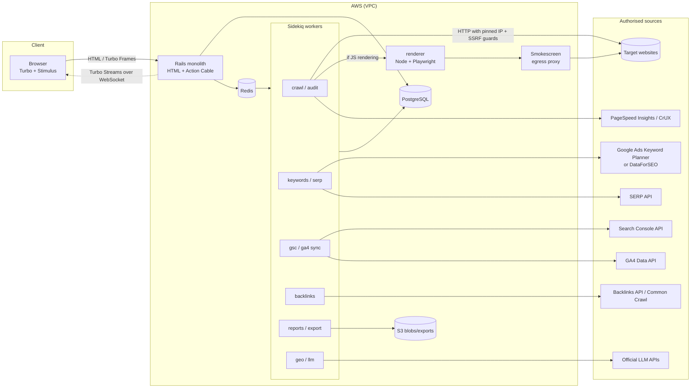
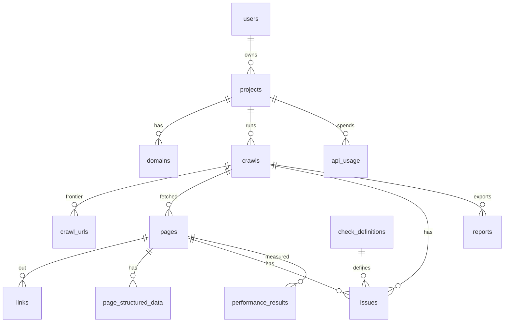

# Phase 2 — Architecture

## 1. Stack and decisions

| Layer | Choice | Notes / reasons for changes |
|---|---|---|
| Application | **Rails 8 monolith** (HTML + jobs), Ruby 3.3 | *Changed 2026-10-17 (ADR 0006)*: previously Rails API + SPA. Modular monolith (see §3). |
| Frontend | **Hotwire (Turbo + Stimulus) with importmap and Propshaft** | No Node, no build step. Live progress with Turbo Streams over Action Cable (Redis). Replaces React + Vite (ADR 0006). |
| Languages | **English by default, Spanish available** | Rails I18n; each user picks a language in the top bar (`User#locale`). See ADR 0010. |
| Database | **PostgreSQL 16** | 15.3 locally (fine for development). Partitioning by `crawl_id` for page/issue tables if needed. `jsonb` for provider data. |
| Jobs | **Sidekiq 7 + Redis 7** | Redis 7.0 installed. Separate queues per module (§4). `sidekiq-cron` for scheduling. |
| HTML parsing | **Nokogiri** | Fast, mature. |
| Crawler HTTP | **Own client on top of `Net::HTTP` with the connection pinned to an IP** | Required for the SSRF / DNS rebinding defence (see 03 §3). |
| JS rendering | **Playwright (Node 22) as a separate `renderer` service** | *Documented change*: instead of calling Playwright from Ruby, an isolated Node microservice. Reason: the browser is the riskiest component (SSRF, memory use); isolating it in its own container with controlled egress limits the damage. Only used when the user enables "render JS". |
| Egress | **Smokescreen** (egress proxy, Stripe, OSS) | *Added*: a second SSRF layer for the renderer (the browser resolves DNS on its own and the IP cannot be pinned from Ruby). |
| Blob storage | **S3** (locally: disk or MinIO) | Compressed raw HTML (optional, with retention), PDF/CSV exports. *The MVP stores reports in Postgres (ADR 0009).* |
| Auth | Cookie session (Rails 8 `authentication` generator) + Google OAuth for GSC/GA4 | Personal use: one user or a few; no complex multi-tenancy in the MVP. |
| Secrets | Rails credentials (dev) / environment variables or AWS Secrets Manager (prod) | OAuth tokens encrypted with Active Record Encryption. |
| Tests | RSpec, FactoryBot, WebMock/VCR; system specs with Capybara + Cuprite (headless Chrome over CDP) | |
| Deployment | Today: Render free plan (see [deploy.md](deploy.md)). Later on AWS: ECS Fargate (app, worker, renderer), RDS Postgres, ElastiCache Redis, S3, CloudFront | Lower-cost option for personal use: a single EC2 with Kamal (bundled with Rails 8). See §8. |

## 2. Architecture diagram



## 3. Modules (modular monolith)

One repository and one deployment, with explicit boundaries. Each module lives in `app/modules/<name>/` (services, value objects, adapters) under its own Ruby namespace; models and jobs stay in their Rails folders. Dependencies between modules may later be enforced with **packwerk**.

| Module | Responsibility | Depends on |
|---|---|---|
| `Core` | Users, projects, verified domains, settings, API budgets | — |
| `SafeHttp` | HTTP client with SSRF guards, robots.txt, per-host rate limiting | — |
| `Crawling` | URL frontier, fetch, parse, storage of pages/links | SafeHttp, Core |
| `Audit` | Check catalogue, issues, health score, prioritisation, diff | Crawling |
| `Performance` | PSI/CrUX per URL | SafeHttp (Google hosts only), Core |
| `SearchConsole` | OAuth, Search Analytics sync, sitemaps, URL Inspection | Core |
| `Analytics` | GA4 (traffic, AI referrers) | Core |
| `Keywords` | Metrics, ideas, clusters, lists, own KD | Core, providers |
| `Serp` | SERP snapshots, feature parsing | Core, providers |
| `Competitors` | Discovery, keyword gap, estimated traffic | Keywords, Serp, SearchConsole |
| `Backlinks` | GSC/BWT import, provider, own authority, gap | Core |
| `RankTracking` | Campaigns, positions, visibility, alerts | Serp, SearchConsole |
| `OnPage` | Recommendations per URL/keyword | Crawling, Serp, SearchConsole |
| `Geo` | GEO audit, prompt panel, mentions, sentiment | Crawling, LLM providers |
| `Reporting` | CSV/XLSX/PDF exports, scheduled reports | all (read only) |
| `Providers` | External API adapters with cost accounting and caching | Core |

Rule: domain modules never call an external API directly; they always go through `Providers::<X>`, which records cost, applies caching and enforces the monthly budget.

## 4. Sidekiq queues

| Queue | Initial concurrency | Jobs |
|---|---|---|
| `crawl` | 10 | `Crawling::FetchLaneJob` (one lane per worker slot) |
| `crawl_control` | 2 | `StartCrawlJob`, `FinalizeCrawlJob`, `SitemapDiscoveryJob` |
| `audit` | 4 | `Audit::RunJob` and site-wide checks |
| `external` | 3 | PSI, GSC, GA4, providers (with per-provider rate limits) |
| `geo` | 2 | LLM prompts |
| `reports` | 2 | exports |
| `default` | 2 | everything else |

The crawler's per-host rate limit **does not depend on concurrency**: a GCRA limiter in Redis per `host` (atomic Lua) decides whether a job may make the request (ADR 0003/0004).

## 5. Database schema (MVP + extensions)

### 5.1 ER diagram (MVP)



### 5.2 Tables (summarised DDL)

Design-time sketch; the source of truth is `db/schema.rb`.

```sql
-- Core
users(id, email citext unique, password_digest,
      locale text default 'en',                         -- interface language (ADR 0010)
      created_at, updated_at)
projects(id, user_id fk, name, created_at, updated_at,
         monthly_api_budget_cents int default 0)
domains(id, project_id fk, host text not null,          -- "example.com"
        verification_method text,                        -- gsc|dns_txt|html_file|meta
        verification_token text, verified_at timestamptz,
        unique(project_id, host))

-- Crawling
crawls(id, project_id fk, domain_id fk,
       status text,          -- queued|running|paused|completed|failed|cancelled
       config jsonb,         -- start_url, scope, max_pages, max_depth, rps, include/exclude regex,
                             -- user_agent_profile, device, render_js, respect_robots (always true),
                             -- sitemap_discovery, max_page_bytes
       robots_txt text, robots_fetched_at timestamptz,
       pages_discovered int, pages_crawled int, pages_failed int,
       health_score numeric(5,2), started_at, finished_at, error text,
       created_at, updated_at)

crawl_urls(id bigserial, crawl_id fk, url text, url_hash bytea,   -- sha256 of the normalised URL
           depth int, source text,          -- seed|sitemap|link|redirect
           state text,                      -- pending|fetching|done|skipped|failed
           skip_reason text,                -- robots|out_of_scope|limit|excluded|unsafe_host
           attempts int default 0, enqueued_at, unique(crawl_id, url_hash))

pages(id bigserial, crawl_id fk, crawl_url_id fk, url text, final_url text,
      status_code int, redirect_chain jsonb,     -- [{url,status}]
      content_type text, content_length int, response_ms int,
      fetched_at timestamptz, depth int,
      title text, title_length int, meta_description text, meta_description_length int,
      h1 text[], headings jsonb,                 -- [{level,text}] in order
      canonical text, canonical_status text,     -- self|other|missing|invalid|cross_domain
      meta_robots text, x_robots_tag text, indexable boolean, indexability_reason text,
      lang text, hreflang jsonb, word_count int, text_hash bytea,  -- simhash for duplicates
      title_hash bytea, description_hash bytea,
      inlinks_count int, outlinks_internal int, outlinks_external int,
      internal_pagerank numeric, in_sitemap boolean,
      html_s3_key text, render_mode text)        -- raw|rendered

links(id bigserial, crawl_id, from_page_id fk, to_url text, to_url_hash bytea,
      to_page_id fk null, internal boolean, anchor text, rel text[],   -- nofollow, ugc, sponsored
      tag text,          -- a|img|link|script
      status_code int null)  -- filled in when the target is resolved

page_structured_data(id, page_id fk, format text,   -- json-ld|microdata|rdfa
      types text[], raw jsonb, valid boolean, errors jsonb, warnings jsonb)

check_definitions(id, key text unique,           -- e.g. "title.missing"
      category text, severity text,               -- error|warning|notice
      weight int, version int)
      -- titles, descriptions and fixes live in config/locales/checks.{en,es}.yml (ADR 0010)

issues(id bigserial, crawl_id fk, page_id fk null,   -- null = site-wide issue
       check_key text fk, details jsonb, priority_score numeric,
       unique(crawl_id, check_key, page_id))

performance_results(id, page_id fk null, url text, strategy text, -- mobile|desktop
      source text,               -- psi_lab|crux_field
      performance_score int, lcp_ms int, cls numeric, inp_ms int, tbt_ms int, fcp_ms int, ttfb_ms int,
      opportunities jsonb, fetched_at)

reports(id, crawl_id fk, kind text, status text, locale text, data bytea, created_at)

api_usage(id, project_id fk, provider text, operation text, units int,
          cost_cents numeric(10,4), cached boolean, created_at)
```

**Volume note**: a 50,000-URL crawl ≈ 50k `pages`, ~2–5 M `links`. For personal use, `(crawl_id, ...)` indexes plus deleting old crawls (configurable retention, e.g. the last 10 per domain) are enough. Partitioning is only introduced if the tables go past ~50 M rows.

### 5.3 Tables for later modules (summary)

```sql
gsc_properties(id, project_id, site_url, permission_level, oauth_credential_id, last_synced_at)
gsc_search_analytics(property_id, date, query, page, country, device,
                     clicks int, impressions int, ctr numeric, position numeric)
  -- composite PK; partition by month
oauth_credentials(id, user_id, provider, scopes text[], access_token_enc, refresh_token_enc, expires_at)
ga4_daily_sources(property_id, date, session_source, session_medium, landing_page, sessions, engaged_sessions, conversions)

keywords(id, text, country, language, unique(text,country,language))
keyword_metrics(keyword_id, source, volume int, cpc numeric, competition numeric,
                trend int[], intent text, kd numeric, fetched_at)
keyword_lists(id, project_id, name); keyword_list_items(list_id, keyword_id, tags text[])
keyword_clusters(id, project_id, name, method); keyword_cluster_items(cluster_id, keyword_id)

serp_snapshots(id, keyword_id, engine, device, location_code, fetched_at, provider, raw_s3_key)
serp_results(snapshot_id, rank int, type text, url text, domain text, title text, features jsonb)

competitors(id, project_id, domain, source, overlap_score)
domain_keyword_rankings(domain, keyword_id, position, url, source, fetched_at)

backlinks(id, target_domain, source_url, target_url, anchor, rel text[], first_seen, last_seen, source)
referring_domains(target_domain, domain, backlinks_count, authority_estimate, first_seen, last_seen)

rank_campaigns(id, project_id, domain, engine, device, location_code, frequency)
rank_keywords(campaign_id, keyword_id); rank_positions(campaign_id, keyword_id, date, position, url, features jsonb, source)

geo_brands(id, project_id, name, aliases text[], truth_sheet text)
geo_prompts(id, project_id, text, topic, country)
geo_runs(id, prompt_id, provider, model, params jsonb, response text, citations jsonb, cost_cents, created_at)
geo_mentions(run_id, brand_id, position int, sentiment numeric, accuracy_flags jsonb)
```

## 6. Application routes (HTML)

*Since 2026-10-17 there is no JSON API (ADR 0006).* The interface is HTML with Turbo; if an integration ever needs one, an `/api` namespace would be added on top of the same services (`Crawling::CreateCrawl`, `Crawling::Lifecycle`, `Audit::Summary`…).

| Route | What it does |
|---|---|
| `GET/POST/DELETE /session` | sign in (form), sign out |
| `PATCH /locale` | switch the interface language (saved on the user; kept in the session on the sign-in page) |
| `GET /` · `POST /projects` · `GET/DELETE /projects/:id` | projects |
| `POST /projects/:id/domains` · `DELETE /domains/:id` · `POST /domains/:id/verify` | domains and verification (`method`: `dns_txt`, `html_file`, `meta`) |
| `GET /projects/:id/crawls/new?domain_id=` · `POST /projects/:id/crawls` | crawl form and creation (defaults depend on the domain) |
| `GET /crawls/:id` | live progress (`turbo_stream_from crawl, :progress, locale`), audit, performance, reports, pages |
| `POST /crawls/:id/pause` · `resume` · `cancel` · `audit` | crawl control and re-audit |
| `GET /crawls/:id/pages?status=4xx&after=` | page table (Turbo Frame; "Load more" via Turbo Stream) |
| `GET /crawls/:id/pages/:page_id` | page detail |
| `GET /crawls/:id/issues/:check_key` | findings for one check (lazy frame) |
| `GET /crawls/:id/duplicates?type=title\|description\|content` | duplicate groups |
| `POST /crawls/:id/reports` · `GET /crawls/:id/reports/:report_id` | generate and download CSV/XLSX/PDF reports |
| `GET /bot` | public page about the crawler (linked from its User-Agent) |
| `/cable` | Action Cable; authenticated connections only |

## 7. Development roadmap

| Phase | Weeks (1 dev; part time ≈ ×2) | Deliverable | Data cost |
|---|---|---|---|
| **0. Skeleton** | 1 | Repo, Rails + Hotwire + Postgres + Sidekiq, CI, auth, projects/domains, domain verification | 0 |
| **1. Technical crawler MVP** | 5–6 | Epics A–F of [04-backlog.md](04-backlog.md): SafeHttp, crawling, checks, score, PSI, reports | 0 |
| 2. Search Console + GA4 | 2 | OAuth, sync, performance, striking distance, issue prioritisation by impressions | 0 |
| 3. On-page + technical GEO | 2 | Recommendations per URL, AI bot audit, AI traffic in GA4 | 0 |
| 4. Keywords | 2–3 | Research through Keyword Planner or DataForSEO, lists, clusters, own KD | low |
| 5. Rank tracking | 2 | GSC + SERP API campaigns, visibility, alerts | low–medium |
| 6. Competitors + Keyword Gap | 2–3 | Discovery, gap, estimated traffic | medium |
| 7. GEO prompts | 2–3 | Multi-LLM prompt panel, mentions, citations, sentiment | medium (tokens) |
| 8. Backlinks | 3+ | GSC/BWT import, approximate authority (Common Crawl), optional provider | 0 → high |
| 9. Advanced reporting | 2 | Scheduled reports, combined dashboards | 0 |

## 8. Deployment

- **Today**: Render free plan with a Blueprint (web service with Sidekiq embedded in Puma, Postgres, Key Value). See [deploy.md](deploy.md).
- **Option A (recommended for personal use once it outgrows the free plan)**: one EC2 `t4g.medium` (or Lightsail) with **Kamal 2** (bundled with Rails 8): containers for app, worker, renderer, smokescreen, Postgres and Redis (or RDS `db.t4g.micro` for managed backups). About 30–60 USD/month.
- **Option B (scalable)**: ECS Fargate (app, worker, renderer), RDS, ElastiCache, S3, CloudFront, ALB. More expensive (≈ 120–250 USD/month at minimum).
- In both: IMDSv2 required with *hop limit* 1, security groups that deny egress to private ranges from the crawl/render containers, renderer subnet without access to RDS/Redis.
