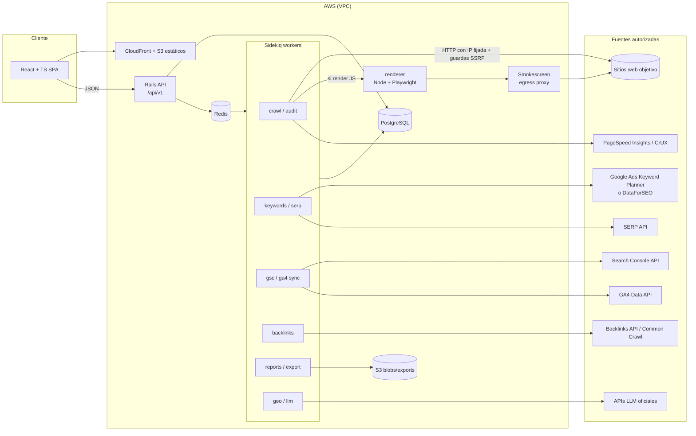
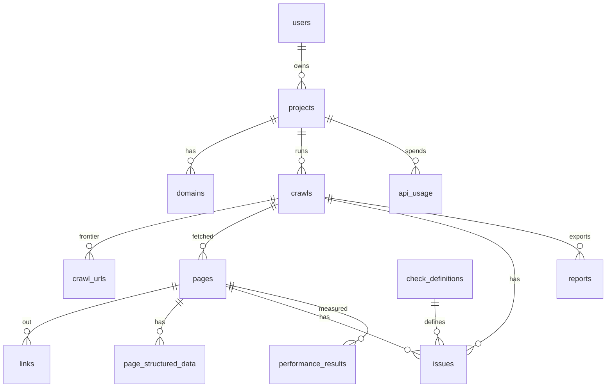

# Fase 2 — Arquitectura

## 1. Stack y decisiones

| Capa | Elección | Notas / justificación de cambios |
|---|---|---|
| API | **Rails 8 API-only**, Ruby 3.3 | Instalados localmente: Ruby 3.3.0, Rails 8.0.5. Monolito modular (ver §3). |
| Frontend | **React 18 + TypeScript + Vite** | TanStack Query para datos, TanStack Table para tablas grandes, Recharts para gráficos. |
| BD | **PostgreSQL 16** | Local hay 15.3 (sirve para desarrollo). Particionado por `crawl_id` en tablas de páginas/issues. `jsonb` para datos de proveedores. |
| Jobs | **Sidekiq 7 + Redis 7** | Redis 7.0 instalado. Colas separadas por módulo (§4). `sidekiq-cron` para programación. |
| Parsing HTML | **Nokogiri** | Rápido, maduro. |
| HTTP del crawler | **Cliente propio sobre `Net::HTTP`/`httpx` con conexión fijada a IP** | Necesario para la defensa SSRF/DNS rebinding (ver 03 §3). |
| Render JS | **Playwright (Node 22) como servicio separado `renderer`** | *Cambio documentado*: en vez de llamar a Playwright desde Ruby, un microservicio Node aislado. Razón: el navegador es el componente de mayor riesgo (SSRF, consumo de memoria); aislarlo en su propio contenedor con egress controlado limita el daño. Solo se usa si el usuario activa "render JS". |
| Egress | **Smokescreen** (proxy de salida, Stripe, OSS) | *Añadido*: segunda capa SSRF para el renderer (el navegador resuelve DNS por su cuenta y no se puede fijar la IP desde Ruby). |
| Almacenamiento de blobs | **S3** (local: disco o MinIO) | HTML crudo comprimido (opcional, con retención), exportaciones PDF/CSV. |
| Auth | Sesión por cookie (Rails 8 `authentication` generator) + OAuth Google para GSC/GA4 | Uso personal: un único usuario o pocos; sin multi-tenant complejo en el MVP. |
| Secretos | Rails credentials (dev) / AWS Secrets Manager (prod) | Tokens OAuth cifrados con Active Record Encryption. |
| Tests | RSpec, FactoryBot, WebMock/VCR, Vitest + Testing Library, Playwright Test (E2E) | |
| Despliegue | AWS: ECS Fargate (api, worker, renderer), RDS Postgres, ElastiCache Redis, S3, CloudFront | Alternativa de menor coste para uso personal: una sola EC2 con Kamal (incluido en Rails 8). Ver §8. |

## 2. Diagrama de arquitectura



## 3. Módulos (monolito modular)

Un solo repositorio y despliegue, con fronteras explícitas. Cada módulo vive en `app/modules/<nombre>/` (modelos, servicios, jobs, serializers) con su namespace Ruby, y las dependencias entre módulos se verifican con **packwerk**.

| Módulo | Responsabilidad | Depende de |
|---|---|---|
| `Core` | Usuarios, proyectos, dominios verificados, settings, presupuestos de API | — |
| `SafeHttp` | Cliente HTTP con guardas SSRF, robots.txt, rate limiting por host | — |
| `Crawling` | Frontera de URLs, fetch, parse, almacenamiento de páginas/enlaces | SafeHttp, Core |
| `Audit` | Catálogo de checks, issues, health score, priorización, diff | Crawling |
| `Performance` | PSI/CrUX por URL | SafeHttp (solo hosts de Google), Core |
| `SearchConsole` | OAuth, sync de Search Analytics, sitemaps, URL Inspection | Core |
| `Analytics` | GA4 (tráfico, referrers de IA) | Core |
| `Keywords` | Métricas, ideas, clusters, listas, KD propio | Core, proveedores |
| `Serp` | Snapshots de SERP, parse de features | Core, proveedores |
| `Competitors` | Descubrimiento, keyword gap, tráfico estimado | Keywords, Serp, SearchConsole |
| `Backlinks` | Import GSC/BWT, proveedor, autoridad propia, gap | Core |
| `RankTracking` | Campañas, posiciones, visibilidad, alertas | Serp, SearchConsole |
| `OnPage` | Recomendaciones por URL/keyword | Crawling, Serp, SearchConsole |
| `Geo` | Auditoría GEO, panel de prompts, menciones, sentimiento | Crawling, proveedores LLM |
| `Reporting` | Exportaciones CSV/XLSX/PDF, informes programados | todos (solo lectura) |
| `Providers` | Adaptadores de APIs externas con contabilidad de coste y caché | Core |

Regla: los módulos de dominio nunca llaman directamente a una API externa; siempre vía `Providers::<X>` que registra coste, aplica caché y respeta el presupuesto mensual.

## 4. Colas Sidekiq

| Cola | Concurrencia inicial | Jobs |
|---|---|---|
| `crawl` | 10 | `Crawling::FetchPageJob` (uno por URL) |
| `crawl_control` | 2 | `StartCrawlJob`, `FinalizeCrawlJob`, `SitemapDiscoveryJob` |
| `audit` | 4 | `Audit::RunChecksJob`, `Audit::SiteWideChecksJob`, `Audit::ScoreJob` |
| `external` | 3 | PSI, GSC, GA4, proveedores (con rate limit por proveedor) |
| `geo` | 2 | prompts LLM |
| `reports` | 2 | exportaciones |
| `default` | 2 | resto |

El rate limit por host del crawler **no depende de la concurrencia**: un token bucket en Redis por `host` (Lua atómico) decide si un job puede hacer la petición; si no, se re-encola con `perform_in`.

## 5. Esquema de base de datos (MVP + extensiones)

### 5.1 Diagrama ER (MVP)



### 5.2 Tablas (DDL resumido)

```sql
-- Core
users(id, email citext unique, password_digest, created_at, updated_at)
projects(id, user_id fk, name, created_at, updated_at,
         monthly_api_budget_cents int default 0)
domains(id, project_id fk, host text not null,          -- "example.com"
        verification_method text,                        -- gsc|dns_txt|html_file|meta
        verification_token text, verified_at timestamptz,
        unique(project_id, host))

-- Crawling
crawls(id, project_id fk, domain_id fk,
       status text,          -- queued|running|paused|completed|failed|cancelled
       config jsonb,         -- start_url, scope, max_pages, max_depth, rps, include/exclude regex,
                             -- user_agent_profile, device, render_js, respect_robots(true fijo),
                             -- sitemap_discovery, max_page_bytes
       robots_txt text, robots_fetched_at timestamptz,
       pages_discovered int, pages_crawled int, pages_failed int,
       health_score numeric(5,2), started_at, finished_at, error text,
       created_at, updated_at)

crawl_urls(id bigserial, crawl_id fk, url text, url_hash bytea,   -- sha256 de URL normalizada
           depth int, source text,          -- seed|sitemap|link|redirect
           state text,                      -- pending|fetching|done|skipped|failed
           skip_reason text,                -- robots|out_of_scope|limit|excluded|unsafe_host
           attempts int default 0, enqueued_at, unique(crawl_id, url_hash))
  PARTITION BY LIST (crawl_id) -- o hash; ver nota

pages(id bigserial, crawl_id fk, crawl_url_id fk, url text, final_url text,
      status_code int, redirect_chain jsonb,     -- [{url,status}]
      content_type text, content_length int, response_ms int,
      fetched_at timestamptz, depth int,
      title text, title_length int, meta_description text, meta_description_length int,
      h1 text[], headings jsonb,                 -- [{level,text}] en orden
      canonical text, canonical_status text,     -- self|other|missing|invalid|cross_domain
      meta_robots text, x_robots_tag text, indexable boolean, indexability_reason text,
      lang text, hreflang jsonb, word_count int, text_hash bytea,  -- simhash p/ duplicados
      title_hash bytea, description_hash bytea,
      inlinks_count int, outlinks_internal int, outlinks_external int,
      internal_pagerank numeric, in_sitemap boolean,
      html_s3_key text, render_mode text)        -- raw|rendered

links(id bigserial, crawl_id, from_page_id fk, to_url text, to_url_hash bytea,
      to_page_id fk null, internal boolean, anchor text, rel text[],   -- nofollow, ugc, sponsored
      tag text,          -- a|img|link|script
      status_code int null)  -- rellenado al resolver destino

page_structured_data(id, page_id fk, format text,   -- json-ld|microdata|rdfa
      types text[], raw jsonb, valid boolean, errors jsonb, warnings jsonb)

check_definitions(id, key text unique,           -- p.ej. "title.missing"
      category text, severity text,               -- error|warning|notice
      weight int, title_es text, description_es text, how_to_fix_es text, version int)

issues(id bigserial, crawl_id fk, page_id fk null,   -- null = issue de sitio
       check_key text fk, details jsonb, priority_score numeric,
       unique(crawl_id, check_key, page_id))

performance_results(id, page_id fk null, url text, strategy text, -- mobile|desktop
      source text,               -- psi_lab|crux_field
      performance_score int, lcp_ms int, cls numeric, inp_ms int, tbt_ms int, fcp_ms int, ttfb_ms int,
      opportunities jsonb, fetched_at)

reports(id, crawl_id fk, format text, status text, s3_key text, created_at)

api_usage(id, project_id fk, provider text, operation text, units int,
          cost_cents numeric(10,4), cached boolean, created_at)
```

**Nota de volumen**: un crawl de 50 000 URLs ≈ 50k `pages`, ~2–5 M `links`. Para uso personal basta con índices `(crawl_id, ...)` y borrar crawls viejos (retención configurable, p. ej. últimos 10 por dominio). El particionado se introduce solo si las tablas superan ~50 M filas.

### 5.3 Tablas de módulos posteriores (resumen)

```sql
gsc_properties(id, project_id, site_url, permission_level, oauth_credential_id, last_synced_at)
gsc_search_analytics(property_id, date, query, page, country, device,
                     clicks int, impressions int, ctr numeric, position numeric)
  -- PK compuesta; particionar por mes
oauth_credentials(id, user_id, provider, scopes text[], access_token_enc, refresh_token_enc, expires_at)
ga4_daily_sources(property_id, date, session_source, session_medium, landing_page, sessions, engaged_sessions, conversions)

keywords(id, text, country, language, unique(text,country,language))
keyword_metrics(keyword_id, source, volume int, cpc numeric, competition numeric,
                trend int[], intent text, kd numeric, fetched_at)
keyword_lists(id, project_id, name); keyword_list_items(list_id, keyword_id, tags text[])
keyword_clusters(id, project_id, name, method); keyword_cluster_items(cluster_id, keyword_id)

serp_snapshots(id, keyword_id, engine, device, location_code, fetched_at, provider, raw_s3_key)
serp_results(snapshot_id, rank int, type text, url text, domain text, title text, features jsonb)

competitors(id, project_id, domain, source, overlap_score)
domain_keyword_rankings(domain, keyword_id, position, url, source, fetched_at)

backlinks(id, target_domain, source_url, target_url, anchor, rel text[], first_seen, last_seen, source)
referring_domains(target_domain, domain, backlinks_count, authority_estimate, first_seen, last_seen)

rank_campaigns(id, project_id, domain, engine, device, location_code, frequency)
rank_keywords(campaign_id, keyword_id); rank_positions(campaign_id, keyword_id, date, position, url, features jsonb, source)

geo_brands(id, project_id, name, aliases text[], truth_sheet text)
geo_prompts(id, project_id, text, topic, country)
geo_runs(id, prompt_id, provider, model, params jsonb, response text, citations jsonb, cost_cents, created_at)
geo_mentions(run_id, brand_id, position int, sentiment numeric, accuracy_flags jsonb)
```

## 6. Contratos de API (REST JSON, `/api/v1`)

Convenciones: JSON:API-lite (`{data, meta, errors}`), paginación por cursor (`?cursor=&limit=`), filtros `filter[campo]=`, orden `sort=-campo`, errores `{errors:[{code, detail, field}]}`, IDs numéricos. Especificación formal en OpenAPI 3.1 generada con **rswag** desde los specs.

### 6.1 Proyectos y dominios

| Método | Ruta | Cuerpo / query | Respuesta |
|---|---|---|---|
| POST | `/projects` | `{name}` | `201 {data: project}` |
| GET | `/projects` | — | lista |
| POST | `/projects/:id/domains` | `{host}` | `201 {data:{id, host, verification:{method_options, token}}}` |
| POST | `/domains/:id/verify` | `{method: "dns_txt"\|"html_file"\|"meta"\|"gsc"}` | `200 {verified_at}` o `422 {code:"verification_failed"}` |

### 6.2 Crawls (MVP)

```http
POST /api/v1/projects/:project_id/crawls
{
  "domain_id": 12,
  "start_url": "https://example.com/",
  "scope": "domain",              // domain | subdomain | subfolder
  "max_pages": 5000,               // tope duro por plan: 50 000 (verificado), 200 (no verificado)
  "max_depth": 10,
  "requests_per_second": 2,        // 0.2–10 (verificado), máx 0.5 (no verificado)
  "include_patterns": [], "exclude_patterns": ["^/wp-admin"],
  "device": "desktop",            // desktop | mobile (cambia UA y viewport)
  "render_js": false,
  "use_sitemaps": true,
  "run_pagespeed": {"enabled": true, "sample_size": 20, "strategy": "mobile"}
}
→ 202 {"data": {"id": 345, "status": "queued", "links": {"self": "/api/v1/crawls/345"}}}
→ 422 {"errors":[{"code":"domain_not_verified"|"unsafe_target"|"invalid_scope", ...}]}
```

| Método | Ruta | Descripción |
|---|---|---|
| GET | `/crawls/:id` | estado, progreso (`pages_discovered/crawled/failed`), `health_score`, tiempos |
| POST | `/crawls/:id/pause` · `/resume` · `/cancel` | control |
| GET | `/crawls/:id/pages` | `filter[status_code]=404`, `filter[indexable]=false`, `filter[url_contains]=`, `sort=-inlinks_count` |
| GET | `/crawls/:id/pages/:page_id` | detalle: metadatos, headings, enlaces in/out, schema, issues, rendimiento |
| GET | `/crawls/:id/issues/summary` | `{health_score, by_severity:{error,warning,notice}, by_category:[{category, score, count}]}` |
| GET | `/crawls/:id/issues` | agrupado por check: `[{check_key, severity, title, how_to_fix, pages_affected, priority_score}]` |
| GET | `/crawls/:id/issues/:check_key/pages` | páginas afectadas con `details` |
| GET | `/crawls/:id/links` | `filter[broken]=true`, `filter[internal]=true` |
| GET | `/crawls/:id/duplicates` | `?type=title\|description\|content` → grupos `{hash, urls[]}` |
| GET | `/crawls/:id/compare/:other_id` | `{new_issues, resolved_issues, score_delta}` |
| POST | `/crawls/:id/reports` | `{format:"csv"\|"xlsx"\|"pdf", sections:[...]}` → `202 {report_id}` |
| GET | `/reports/:id` | `{status, download_url}` (URL S3 prefirmada, 15 min) |
| POST | `/projects/:id/crawl_schedules` | `{domain_id, cron:"weekly", config}` |

Ejemplo de issue:

```json
{
  "check_key": "links.internal_broken",
  "category": "links",
  "severity": "error",
  "title": "Enlaces internos rotos",
  "how_to_fix": "Actualiza o elimina los enlaces que apuntan a URLs con 4xx/5xx.",
  "pages_affected": 37,
  "priority_score": 82.4,
  "sample": [{"page_url": "https://example.com/blog/a", "details": {"to_url": "https://example.com/old", "status": 404}}]
}
```

### 6.3 Integraciones y módulos posteriores

| Método | Ruta | Descripción |
|---|---|---|
| GET | `/oauth/google/start?scopes=gsc,ga4` · `/oauth/google/callback` | OAuth (scopes `webmasters.readonly`, `analytics.readonly`) |
| GET | `/gsc/properties` · POST `/gsc/properties/:id/sync` | listar / sincronizar |
| GET | `/gsc/properties/:id/performance` | `dimensions=query,page&start=&end=&filter[...]` |
| GET | `/gsc/properties/:id/striking_distance` | pares query–page en posición 4–20 |
| POST | `/keywords/research` | `{seed, country, language, limit}` → `202` job / `200` si cacheado |
| GET | `/keywords/:id` | métricas + fuente + fecha |
| POST | `/keyword_lists` · `/keyword_lists/:id/items` | listas |
| POST | `/keyword_clusters` | `{keyword_ids, method:"serp_overlap"\|"embeddings"}` |
| POST | `/competitors/discover` | `{project_id}` → candidatos con `overlap_score` |
| POST | `/keyword_gap` | `{target, competitors[≤4], country, device}` → `{shared, missing, weak, strong, untapped, unique}` |
| GET | `/backlinks/:domain` · `/referring_domains/:domain` | perfil (fuente indicada) |
| POST | `/backlinks/import` | multipart CSV de GSC |
| POST | `/backlink_gap` | `{target, competitors[]}` |
| CRUD | `/rank_campaigns` · GET `/rank_campaigns/:id/positions` | seguimiento |
| POST | `/onpage/recommendations` | `{url, keyword}` |
| CRUD | `/geo/brands` · `/geo/prompts` · POST `/geo/runs` · GET `/geo/visibility` | GEO |
| GET | `/usage` | gasto de API por proveedor y mes vs presupuesto |

## 7. Roadmap de desarrollo

| Fase | Semanas (1 dev, tiempo parcial ≈ ×2) | Entregable | Coste de datos |
|---|---|---|---|
| **0. Esqueleto** | 1 | Repo, Rails API + React + Postgres + Sidekiq, CI, auth, proyectos/dominios, verificación de dominio | 0 |
| **1. MVP crawler técnico** | 5–6 | Épicas A–F de [04-backlog.md](04-backlog.md): SafeHttp, crawling, checks, score, PSI, informes | 0 |
| 2. Search Console + GA4 | 2 | OAuth, sync, rendimiento, striking distance, priorización de issues por impresiones | 0 |
| 3. On-page + GEO técnico | 2 | Recomendaciones por URL, auditoría de bots IA, tráfico IA en GA4 | 0 |
| 4. Keywords | 2–3 | Investigación vía Keyword Planner o DataForSEO, listas, clusters, KD propio | bajo |
| 5. Rank tracking | 2 | Campañas GSC + SERP API, visibilidad, alertas | bajo-medio |
| 6. Competidores + Keyword Gap | 2–3 | Descubrimiento, gap, tráfico estimado | medio |
| 7. GEO prompts | 2–3 | Panel de prompts multi-LLM, menciones, citas, sentimiento | medio (tokens) |
| 8. Backlinks | 3+ | Import GSC/BWT, autoridad aproximada (Common Crawl), proveedor opcional | 0 → alto |
| 9. Reporting avanzado | 2 | Informes programados, dashboards combinados | 0 |

## 8. Despliegue

- **Opción A (recomendada para uso personal)**: 1 EC2 `t4g.medium` (o Lightsail) con **Kamal 2** (viene con Rails 8): contenedores api, worker, renderer, smokescreen, Postgres y Redis (o RDS `db.t4g.micro` si se quiere backup gestionado). Coste aprox. 30–60 USD/mes.
- **Opción B (escalable)**: ECS Fargate (api, worker, renderer), RDS, ElastiCache, S3, CloudFront, ALB. Más caro (≈ 120–250 USD/mes en mínimos).
- En ambas: IMDSv2 obligatorio con *hop limit* 1, security groups que niegan egress a rangos privados desde los contenedores de crawl/render, subred del renderer sin acceso a RDS/Redis.
